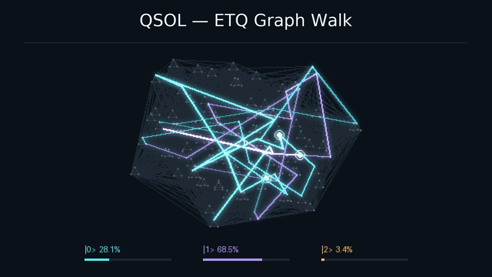

# ETQ Graph Walk

Select **Visualizer → ETQ Graph Walk** in GTK, or:

```sh
./audio2video render song.wav etq.mp4 --visualizer --style etq-graph-walk --title "Name – Track"
```

This local receiver uses the finite ETQ graph from
[QSOLKCB/VIZ](https://github.com/QSOLKCB/VIZ/tree/90a3ab3e72d7f46f3e8e99b1dbd5a68182f4c363),
with three luminous walkers, fading trails and audio-reactive light. It works at
720p or 1080p, with or without a top title, including during silence. It adds no
runtime dependencies, network calls, browser capture or camera controls.



## Exact model and authored receiver

The finite construction is ported from the pinned `js/etq-core.js`:

| Fixture | Value |
| --- | ---: |
| Doubled E8 roots / squared norm | 240 / 8 |
| Ambient triality decomposition | 12 fixed + 76 three-cycles |
| Preserved selector | 2 fixed + 33 three-cycles = 101 labels |
| Selected root families | 41 integer + 60 half-integer |
| Selected graph / degree range | 1,687 edges / 22–55 |
| Cartesian lift `G101 □ C3` | 303 states / 5,364 edges |
| Lifted degree range | 24–57 |

An edge in the base graph has doubled-coordinate dot product four. The lift
connects those edges within each fibre and adds a triangle between the three
external fibre states at every site. Internal triality labels and external fibres
remain distinct. There are **101 selected E8-root labels**, not 303 E8 roots.

The graph walk is an **authored traversal**, separate from VIZ's CRT event orbit
and spirograph. A deterministic depth-first spanning-tree walk visits all 303 states,
including backtracking, and closes after 604 edge moves. Every move, including the
loop boundary, follows an actual lifted-graph edge. This does not claim a Hamiltonian
cycle, traversal of all 5,364 edges, quantum evolution or a quantum measurement.

Three walkers use fixed offsets into that route. Each edge takes eight video frames;
positions interpolate with integer arithmetic. Route phase repeats after 4,832
frames; audio response still follows the current PCM window. Trails reconstruct
only 18 preceding edges, so seeking far into a track does not replay earlier frames.

The receiver uses a committed Q14 quantization of VIZ's golden projection frame,
a fixed view with a quarter-turn roll, and a fitted orthographic projection. Model
construction and adjacency remain exact; screen geometry is a visual projection.
Colours identify the external fibre. Three broad audio-band weights control trail
brightness, and level controls packet size and light intensity. This mapping is
artwork, not an intrinsic acoustic property of E8/ETQ. Titles and the lower legend
have reserved space even at maximum input level.

## Reuse and verification

The model, screen coordinates and static edge raster are computed once. Each cache
holds one immutable result, independent of track length. There is no rendered-frame
history or result cache. This follows the existing OPT reuse approach without
introducing a new performance claim.

Every encoded frame still goes through the common stream/content checks. ETQ adds
a separate neutral-bright packet-core check: at least 80% of the expected sampled
cores must remain bright and neutral. A static graph, visible title or overlapping
trails cannot alone satisfy it. These are lossy-codec tolerance checks at 160x90;
subpixel changes below their sampling/tolerance are not certified.

Tests independently cover root/triality invariants, selector and edge identities,
degrees, lift legality, connectivity, the closed walk, immutable cache rebuilds,
projection bounds, late-frame random access, silence and opposite-phase stereo,
real 720p/1080p exports, repeatability, partial tails and deliberately frozen or
missing walks. Packaged CLI and GTK tests select this style and export real MP4s.

## Donor parity and licence

The pinned JavaScript constructor was executed once for a cross-language comparison.
Compact JSON (arrays, no spaces, no trailing newline) produced these identities:

| Ordered array | SHA-256 |
| --- | --- |
| Selected doubled roots | `97cfd1f087745422fd66d3640c7b86c3209593c4b53741018c08a5e9cdb15f6f` |
| Base edges | `42f6dc6cd014226f1f1b8e59057c083a702cd5639ebd345b21bed6a8280cd8a3` |
| Lifted edge endpoints | `8c48ae287ae30d577894621e4be7120149fd6672e0efd3f782bf15c2a2ee59ef` |

The Python arrays match all three byte for byte; regression tests pin these donor
identities without needing Node.js. This establishes finite-construction parity,
not formal verification of the renderer.

`a2v/etq.py` is an MPL-2.0 adaptation, Copyright 2026 Trent Slade / QSOL-IMC.
The complete licence is in `LICENSES/MPL-2.0.txt` and travels in the Linux package.
The surrounding Audio-to-Video files retain their existing Apache-2.0 licence.
